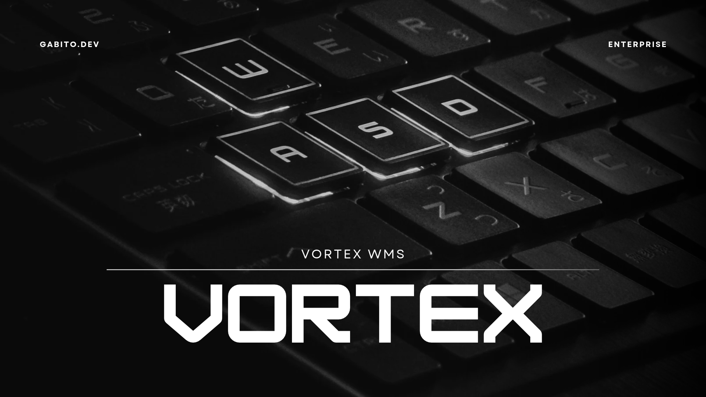

# Vortex WMS

Sistema de gestión de almacenes de la suite **Vortex** (**ERP, CRM, WMS, POS**): libre y de código abierto
(AGPL-3.0), hecho en Perú para LATAM y el mundo. Es una app **.NET MAUI Blazor Hybrid** para Windows, Android, iOS y
macOS que funciona sin conexión y se integra con el resto de la suite a través del hub
[vortex-api](https://github.com/ArcGabito/vortex-api).